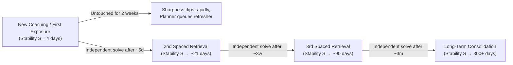
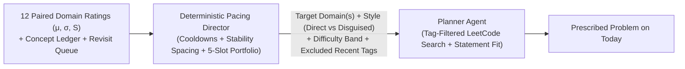

# Design Blueprint (v3): Paired Skill Ratings, Memory Decay & Anti-Rabbit-Hole Selection

> [!NOTE]
> **Design specification (v3 — pre-implementation)** — captures the proposed architecture for paired per-domain `Selection` vs. `Implementation` skill ratings, probe-first concept exposure, FSRS-inspired skill degradation & consolidation across multi-month breaks, deferred reflection queues, two-stage onboarding, and anti-rabbit-hole problem prescription.

---

## 1. Domain Taxonomy + Probe-First Concept Exposure

LeetCode's `problemsetQuestionList` and `questionData` GraphQL queries already return `topicTags { name slug }` in [`spikes/leetcode/client.mjs`](../spikes/leetcode/client.mjs). Rather than tracking all 72 raw LeetCode tags as separate `1000`-baseline scores (which suffers from `Array`/`String` input-type noise and sparse 1–15 problem long-tail tags), we split tracking into two complementary layers:

### Track A — 12 Broad Rated Domains (`1000` Baseline)

Every rated domain has **150–1,500+ LeetCode problems**, avoiding sparse-bucket volatility:

| # | Rated Domain (`1000` scale) | Mapped LeetCode Tags | Supply Notes |
| :--- | :--- | :--- | :--- |
| 1 | **Arrays, Strings & Simulation** | `Array`, `String`, `Matrix`, `Simulation`, `Enumeration`, `Iterator` | Weighted only when direct indexing/parsing/in-place manipulation is the core task—not merely because the input type is `int[]` or `String` |
| 2 | **Hashing & Prefix State** | `Hash Table`, `Counting`, `Hash Function`, `Prefix Sum` | ~1,100+ problems |
| 3 | **Two Pointers & Sliding Window** | `Two Pointers`, `Sliding Window` | ~440+ problems |
| 4 | **Sorting & Intervals** | `Sorting`, `Merge Sort`, `Quickselect`, `Bucket Sort`, `Counting Sort`, `Radix Sort`, `Sweep Line` | ~580+ problems |
| 5 | **Stacks, Queues & Linked Structures** | `Stack`, `Queue`, `Monotonic Stack`, `Monotonic Queue`, `Linked List`, `Doubly-Linked List`, `Design`, `Data Stream` | ~550+ problems |
| 6 | **Binary Search** | `Binary Search` (index search & binary search on answer space) | ~350+ problems |
| 7 | **Heaps & Ordered Collections** | `Heap (Priority Queue)`, `Ordered Set` | ~300+ problems |
| 8 | **Trees & Structural Recursion** | `Tree`, `Binary Tree`, `Binary Search Tree`, `Trie`, `Divide and Conquer` | ~550+ problems |
| 9 | **Graphs & Grid Search** | `Depth-First Search`, `Breadth-First Search`, `Graph Theory`, `Topological Sort`, `Union-Find`, `Shortest Path`, `Minimum Spanning Tree`, `Strongly Connected Component`, `Eulerian Circuit`, `Biconnected Component` | ~700+ problems |
| 10 | **Backtracking & Combinatorial Search** | `Recursion`, `Backtracking`, `Meet in the Middle` | ~170+ problems |
| 11 | **Dynamic Programming** | `Dynamic Programming`, `Memoization` | ~700+ problems |
| 12 | **Greedy, Math & Bitwise** | `Greedy`, `Math`, `Bit Manipulation`, `Bitmask`, `Number Theory`, `Combinatorics`, `Geometry`, `Game Theory`, `Minimax`, `Brainteaser`, `Randomized`, `Probability and Statistics`, `Reservoir Sampling`, `Rejection Sampling` | ~1,200+ problems |

*(Excluded from Java single-solution DSA ratings by default: `Database`, `Shell`, `Concurrency`, `Interactive`. Specialized competitive structures such as `Segment Tree`, `Binary Indexed Tree`, `Rolling Hash`, `String Matching`, and `Suffix Array` live in the Named Concept Ledger below.)*

### Track B — Named Concept Ledger (Probe-First, Not Pre-Gated)

- **Tracked concepts:** Concrete named structures and patterns (`HashMap / HashSet`, `Prefix Sum + Map`, `Converging Two Pointers`, `Fast & Slow Pointers`, `Variable Sliding Window`, `Custom Comparator`, `Monotonic Stack`, `Monotonic Deque`, `Linked-List Reversal`, `LRU (Map + Doubly-Linked List)`, `Binary Search on Answer`, `PriorityQueue (Top-K / Two-Heap)`, `TreeMap / TreeSet`, `DFS Tree Recursion`, `BFS Level-Order`, `Trie`, `Grid BFS/DFS`, `Topological Sort`, `Union-Find (DSU)`, `Dijkstra`, `Backtracking with State Undo`, `1D/2D Tabulation & Memoization`, `Bitmask`, `Segment / Fenwick Tree`, `Rolling Hash / KMP`).
- **States:** `unseen` → `coached / introduced` → `applied-independently` *(paired with a memory stability `S` so rusty concepts resurface naturally)*.
- **Expose first, observe real retrieval:** Self-report checklists overstate rusty knowledge (e.g., knowing `Union-Find` by name from years ago without remembering how to write `find` with path compression or `union` by rank today). Instead of gating behind mandatory pre-reading, DuoLeetCode probes concepts via approachable entry problems (`Easy` / `Low-Medium`) and adapts from the actual attempt:
  - Remembered & implemented cleanly → marks `applied-independently` and builds stability immediately.
  - Solved via a different valid route (e.g., DFS instead of `Union-Find`) or got stuck on mechanics → post-problem coaching teaches/refreshes `Union-Find` in concrete context, sets short initial stability (`S ≈ 4 days`), and schedules a spaced follow-up problem within days so the learner builds it independently before the lesson fades.

---

## 2. Paired Per-Domain Metrics: *Selection (Spotting)* vs. *Implementation (Building)*

Understanding *that* a data structure fits a problem is distinct from *coding* it without bugs. Each of the 12 domains tracks two paired `1000`-scale metrics:

- **`Selection` (Problem → DSA Fit):** Recognizing when a domain's structure/pattern unlocks the problem's constraints, and weighing time/space trade-offs against alternatives.
- **`Implementation` (Code & Invariants):** Writing it cleanly in Java—maintaining loop/recursion invariants, handling boundary cases, and using Java 25 collection APIs accurately.

### Trade-Offs & Guardrails

| Trade-Off | Failure Mode If Unchecked | Mitigation |
| :--- | :--- | :--- |
| **1. Asymmetric signal on signature-obvious problems** | Problems like `reverseList(ListNode head)` or `invertTree(TreeNode root)` hand the data structure to the user in the method signature, inflating `Selection` without testing pattern recognition. | **Signature-forced rule:** When the method signature/problem statement explicitly mandates the structure, update **`Implementation` (`100%`)** and leave **`Selection` (`0%`)** unchanged (unless a non-obvious sub-pattern such as fast/slow cycle detection was required). |
| **2. Slower cold-start if updated independently** | Treating 24 buckets as unrelated halves the sample rate early on. | **Coupled cold-start prior:** On non-obvious problems solved cleanly and independently, *both* `Selection` (spotted the fit) and `Implementation` (coded it cleanly) update together. They diverge only when evidence diverges:<ul><li>*Spotted `Heap`, hit comparator/off-by-one bugs* → `Selection ↑`, `Implementation ↓`</li><li>*Wrote clean $O(n^2 \log n)$ sort, missed $O(n \log k)$ `Heap`* → `Sorting Implementation ↑`, `Heaps Selection ↓`, `Heaps Implementation` unchanged</li><li>*Unused alternative tag when learner's approach was already optimal* → **neutral (`0` change)**</li></ul> |
| **3. Visual clutter from 24 raw numbers** | Showing 24 equal-weight numbers makes progress harder to scan. | **Composite headline + split bar:** Display a single domain headline rating + delta badge on overviews, expanding into `Selection` vs. `Implementation` bars on hover/click and badging any domain where `|Selection - Implementation| ≥ 75`. |
| **4. Direct prescription leverage** | Single scores can't distinguish *what kind* of problem to assign next. | Drives problem style directly:<ul><li>**Low `Implementation`** → clear, direct mechanics problems</li><li>**Low `Selection`** → *"disguised"* problems whose statements never name the target structure</li></ul> |

---

## 3. Skill Degradation, Multi-Month Breaks & Consolidation (`Stability S`)

Static Elo treats a skill practiced yesterday identically to one untouched for six months. To keep interview skills sharp across breaks while modeling how newly taught concepts solidify, each metric and named concept tracks **`(Latent Rating μ, Uncertainty σ, Stability S, lastPracticedAt)`**:

1. **Power-Law Retrievability ($R$, FSRS-style forgetting curve):**
   - For $\Delta t$ days elapsed since `lastPracticedAt` and stability $S$ (days until recall sharpness drops to $90\%$):
     $$R(\Delta t, S) = \left(1 + \frac{\Delta t}{9 \cdot S}\right)^{-1}$$
2. **Spacing-Dependent Consolidation (Anti-Cramming):**
   - **Newly coached / refreshed concept:** $S_0 \approx 4\text{ days}$ — fades quickly if not applied independently soon.
   - **First independent solve:** $S_1 \approx 12\text{ days}$.
   - **Spaced independent retrievals:** Recalling a skill after an interval $\Delta t$ comparable to $S$ multiplies $S$ (`12d → 35d → 110d → 365d+`). Solving three problems on the *same day* ($\Delta t \approx 0$) barely increases $S$, preventing single-day cramming from masquerading as multi-month retention.
   - **Rusty lapse & relearning (`Union-Find` after a long gap):** Struggling on a formerly known concept refreshes coaching and sets a faster **relearning stability (`~7–10 days`)** rather than starting over from scratch.
3. **User-Visible "Effective Sharpness" vs. "Peak Rating" After Breaks:**
   - Rather than erasing hard-won progress during a multi-month hiatus, compute an effective current rating:
     $$\mu_{\text{effective}} = \mu_{\text{anchor}} + R(\Delta t, S)^{\alpha} \cdot (\mu_{\text{latent}} - \mu_{\text{anchor}})$$
     alongside widened uncertainty $\sigma(\Delta t)$.
   - **UX payoff:** Recently learned skills visibly turn **Rusty** within weeks if neglected, whereas deeply consolidated skills stay sharp for months. Returning from a 3-month break shows e.g. `Graphs · 1135 (Rusty · peak 1245)`, and because $\sigma$ expanded during the break, acing **one** refresher problem snaps $\mu_{\text{effective}}$ rapidly back toward `1245` while extending $S$ even further.

---

## 4. Post-Seal Scoring, User-Visible Progress & Deferred Coaching

### A. User-Visible Progress
- **Skill Profile (`Your progress` + compact `Today` summary):** Shows all 12 domain ratings (`1000` baseline), milestone bands (`850 Foundations` · `1000 Developing` · `1150 Solid` · `1300 Strong` · `1450+ Advanced`), `Selection` vs. `Implementation` splits, Sharp/Rusty status, and the **Named Concept Exposure Map**.
- **Immediate post-attempt feedback:** Displays earned rating deltas (`Two Pointers & Sliding Window: 1000 → 1034 (+34)`) and newly applied concepts right after an attempt seals.

### B. Post-Seal Background Attribution + Optional Reflection Refinement
1. **On Attempt Seal (non-blocking background pass):**
   - Evaluates `{ problem, topicTags, finalSource, solvingChunks, jobs, javaHelp, exposure }` against deterministic difficulty bands (`difficulty` + LeetCode `acRate`, bounded within Easy `800–1050`, Medium `1050–1450`, Hard `1450–1850`) and appends an immutable **`attempt-seal` rating event**.
   - **Zero penalty for skipping coaching:** When recorded work + judge acceptance cleanly demonstrate the expected DSA/algorithm, **100% of earned credit applies at seal**.
   - **Familiarity damper:** Reported `Solved before` attempts dampen positive K-factor gains so repeating memorized problems cannot inflate novel problem-solving ratings.
   - **Sandbox isolation:** Test/demonstration attempts never mutate ratings or stability.
2. **Explicit Skip Intent Modal & Pending Reflections Queue:**
   - Clicking **Skip reflection** prompts a lightweight two-choice dialog:
     - **“Come back to coaching later”** (`defer`): Adds the sealed attempt to a **Pending Reflections** shelf on **Today** (ideal for quick 3-minute debriefs later without blocking the user now).
     - **“No coaching needed — move on”** (`skip-confident`): Closes cleanly with zero follow-up reminders.
3. **Reflection Refinement Delta (now or when resumed from Pending Reflections):**
   - Appends an optional **`reflection-refinement` event** only when conversation uncovers evidence invisible to code inspection alone (e.g., rescuing `Selection` when time expired on a sound plan, crediting deliberate trade-off reasoning, or tempering accidental passes built on a confirmed misconception).

---

## 5. Two-Stage Onboarding & Anti-Rabbit-Hole Recommendation Strategy

### A. Onboarding Calibration
1. **Stage 1 — Fixed Curated Breadth Pack (4–5 short, 10–15 min rewarding Easy/Easy+ problems):**
   - Fixed, non-locked Java problems spanning **orthogonal core domains** (`Hashing & Prefix`, `Two Pointers / Sliding Window`, `Stacks / Linked Structures`, `Binary Search`, `Trees / Grid Search`) so Day 1 guarantees breadth, quick wins, and zero single-topic rabbit holes.
   - Wide initial $\sigma = 350$ produces large, satisfying jumps for strong/fast clean solves, plus modest foundational prior spillover.
2. **Stage 2 — Dynamic Calibration Batch (2–3 problems):**
   - Steps up to `~1125–1225` Medium ceiling probes in domains adjacent to effortless Stage 1 solves, and places targeted `~950–1025` disambiguation probes wherever Stage 1 showed heavy Java-API lookups or boundary friction.
   - Existing/imported practice history can replay through the deterministic rating ledger to warm-start `(μ, σ, S)`.

### B. Deterministic Pacing Director (Preventing Planner Rabbit Holes)

To prevent the LLM planner in [`lib/prescription.ts`](../lib/prescription.ts) from fixating on a single weak tag or repeating recent problem shapes, a **Deterministic Pacing Director** selects the **Slot Purpose + Eligible Domains + Difficulty Band** *before* the planner searches LeetCode:

1. **Hard Domain Cooldowns:** Never prescribe the same primary domain twice in a row (`minCooldown = 1–2` sessions), and cap any domain at **max 2 of the last 6 sessions**—even after a failed attempt or newly created revisit target.
2. **Stability-Driven Revisit Spacing:** Freshly coached concepts (`S ≈ 4d`) and missed-selection targets become eligible after **+2 to +3 sessions / ~4–7 days** (never the very next problem, enforcing interleaved retrieval).
3. **Rolling 5-Session Portfolio Mix:**
   - **2 Growth / Stretch slots:** $\mu_{\text{effective}}$ to $\mu_{\text{effective}} + 85$ in cooldown-eligible developing domains (*direct* style if `Implementation` lags; *disguised* style if `Selection` lags).
   - **1 Breadth / Exposure Probe slot:** Targets highest-$\sigma$ domains or probes an approachable entry problem for an `unseen` named concept.
   - **1 Spaced Consolidation / Rust Refresher slot:** Targets concepts nearing their stability window ($R$ dipping toward $85–90\%$) or rusty peak skills after a break.
   - **1 Momentum / Synthesis slot:** $\mu_{\text{effective}} - 40$ to $+20$ combining a strong domain (`1150+`) with another domain to sustain confidence and interview fluency.
4. **Catalog Tag & `acRate` Support:** Extend `LeetCodeClient.list()` to pass `tags` slugs and read `acRate` so the planner can query exact target domains and calibrate difficulty within Easy/Medium/Hard without revealing the target structure in the learner-facing `Why this problem?` rationale.
